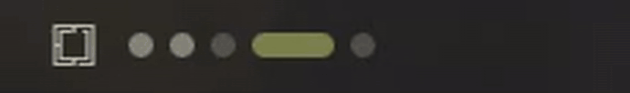
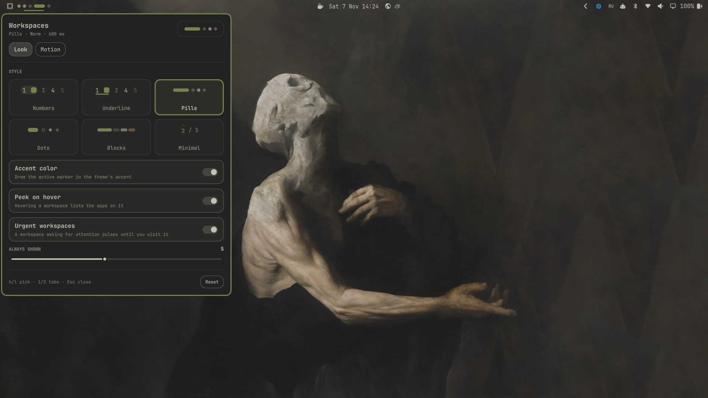
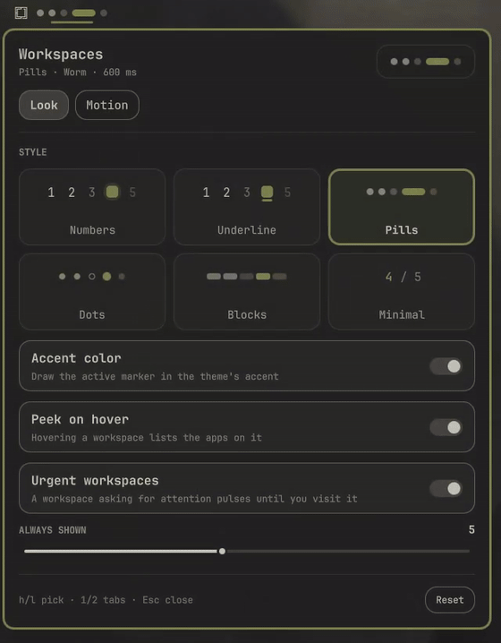
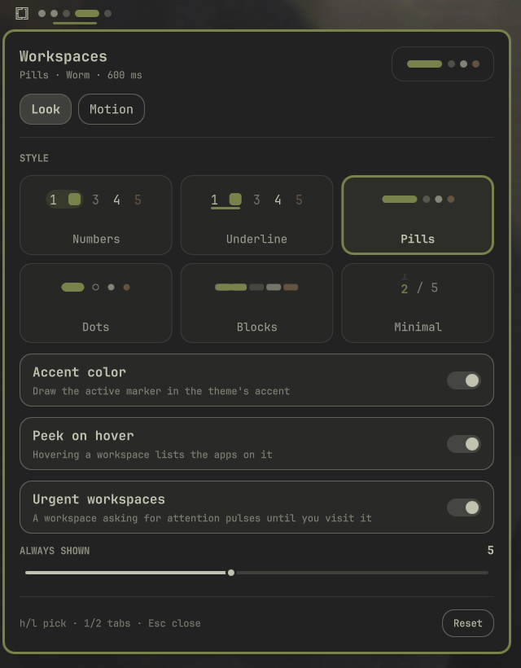
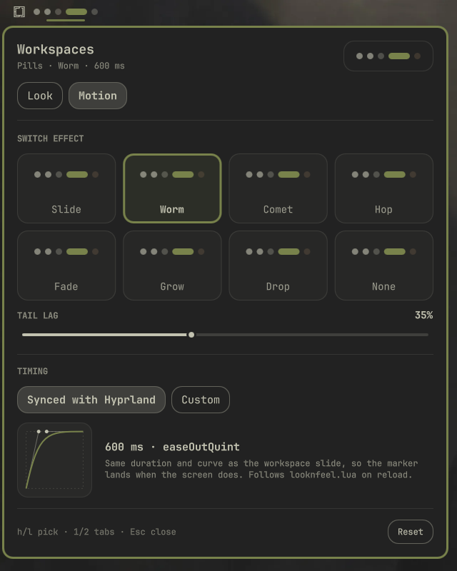

<div align="center">

# Workspace Styler

**Workspace indicators for the [Omarchy](https://omarchy.org) bar — six looks, eight switch animations, timed to the frame with Hyprland's own workspace slide.**

[Русская версия](README.ru.md)



</div>

<br>

<p align="center">
  
</p>

## Why

Omarchy's workspace widget shows numbers. This one lets you pick how the row looks and how the
marker travels when you switch — and makes that motion land **exactly** when the screen does.
It reads the duration and bezier curve of Hyprland's `workspacesIn` animation and runs the
marker on the same curve, so the two move as one. Change `looknfeel.lua` and it follows on reload.

Everything the stock widget does still works: per-monitor workspace blocks, visiting workspaces
from an unplugged monitor, click to focus, click the shown workspace to cycle its layout
(`Super + L` included), and the wheel to walk the row.

## Settings, live

**Right click** the row. Every option is a card with a live preview that keeps switching between
fake workspaces, so what you pick is what you saw.

<p align="center">
  
</p>

<table>
  <tr>
    <td align="center"><br><sub><b>Look</b> — style, accent, peek, urgent, always-shown count</sub></td>
    <td align="center"><br><sub><b>Motion</b> — effect, tail lag, Hyprland-synced or custom timing</sub></td>
  </tr>
</table>

## What's inside

| Looks | Switch effects |
|---|---|
| **Numbers** — the classic, with a soft highlight | **Slide** — the marker glides over |
| **Underline** — numbers with a moving bar | **Worm** — the head stretches out, the tail catches up |
| **Pills** — GNOME / Fedora style dots and a capsule | **Comet** — leaves a tail that burns out on arrival |
| **Dots** — rings for empty, filled for busy | **Hop** — a small jump over the row |
| **Blocks** — solid segments | **Fade** · **Grow** · **Drop** · **None** |
| **Minimal** — just `3 / 5`, the number rolls | |

**Timing**

- **Synced with Hyprland** (default). Duration and curve come from `hyprctl -j animations`,
  walking up the tree `workspacesIn → workspaces → global` like Hyprland does. Animations off in
  Hyprland, or `omarchy toggle animations`, make switches instant.
- **Custom.** Your own duration and curve: Omarchy's, a few classics, any curve defined in your
  Hyprland config, or four bezier points of your own with a live plot.

**Little things**

- **Peek on hover** — hover a workspace to see which apps live there.
- **Urgent workspaces** — a workspace with a window asking for attention breathes in the theme's
  urgent color until you visit it.
- **Accent color** for the marker, **layout icon** on the active number, how many workspaces are
  **always shown**.
- Follows the theme (colors, corner radius, font scale), works on vertical bars, speaks English
  and Russian and switches language live.

## Install

```bash
omarchy plugin add https://github.com/SanchoKusika/omarchy-workspace-styler
```

Put it where the stock widget was and switch that one off:

```bash
omarchy plugin enable io.github.sanchokusika.workspace-styler --section left --after omarchy.workspaces
omarchy plugin disable omarchy.workspaces
```

Update with `omarchy plugin update io.github.sanchokusika.workspace-styler`.

<details>
<summary><b>Going back to the stock widget</b></summary>

```bash
omarchy plugin enable omarchy.workspaces --section left --after io.github.sanchokusika.workspace-styler
omarchy plugin disable io.github.sanchokusika.workspace-styler
```
</details>

## Configuration

The panel writes to the widget's entry in `~/.config/omarchy/shell.json`; you can edit it by hand
too. Every value is validated, anything unknown falls back to the default.

```jsonc
{
  "id": "io.github.sanchokusika.workspace-styler",
  "style": "pills",            // numbers | underline | pills | dots | blocks | minimal
  "effect": "worm",            // slide | worm | comet | hop | fade | grow | drop | none
  "timing": "hyprland",        // hyprland | custom
  "duration": 280,             // ms, custom timing only (0–2000)
  "curve": "omarchy",          // omarchy | outCubic | smooth | inOutCubic | linear | hypr:<name> | custom
  "bezier": [0.23, 1, 0.32, 1],// used when curve is "custom"
  "wormLag": 0.35,             // how far the worm's tail lags, 0.1–0.7
  "accent": false,             // marker in the theme accent
  "layoutGlyph": true,         // layout icon on the active number
  "peek": true,                // apps on hover
  "urgent": true,              // pulse workspaces that ask for attention
  "persistent": 5              // workspaces always shown, 1–10
}
```

### IPC

```bash
omarchy-shell io.github.sanchokusika.workspace-styler toggle        # open / close settings
omarchy-shell io.github.sanchokusika.workspace-styler tab motion    # open on a tab: look | motion
omarchy-shell io.github.sanchokusika.workspace-styler refresh       # re-read layout and Hyprland timing
```

Settings keys: `h` / `l` walk the cards, `1` / `2` switch tabs, `Esc` closes, `Tab` moves to the
next bar panel.

## How the sync works

One linear progress value runs from 0 to 1 over Hyprland's duration. Every moving part — marker
edges, pill widths, ghosts, the hop's arc — is derived from it through the same cubic bezier
Hyprland uses (`Motion.js`). The worm's head and tail run on staggered slices of that span, and
the comet's ghosts on delayed ones, so every effect still finishes at the same moment as the
workspace slide. A switch that interrupts another starts from wherever the marker is.

## Safety

Plugins run unsandboxed inside the shell, so this one is careful with what it shows:

- All its own text is `Text.PlainText`.
- App names for the hover text come from other programs; before they reach the shared tooltip,
  markup-shaped characters are neutralized, control and bidi characters dropped, and length capped.
- `shell.json` values and `hyprctl` output are validated and bounded.
- No network access, nothing executed beyond `hyprctl` and Omarchy's own layout commands.

## Development

```bash
node --test tests/           # bezier, Hyprland parsing, settings, text neutralizing
omarchy plugin validate .
```

Files: `BarWidget.qml` (workspaces, Hyprland timing, settings), `Strip.qml` (drawing and
animation), `Panel.qml` (settings), `CurvePlot.qml`, `Motion.js` (pure logic), `i18n/`.

## License

[MIT](LICENSE) © SanchoKusika
