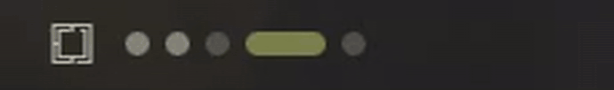
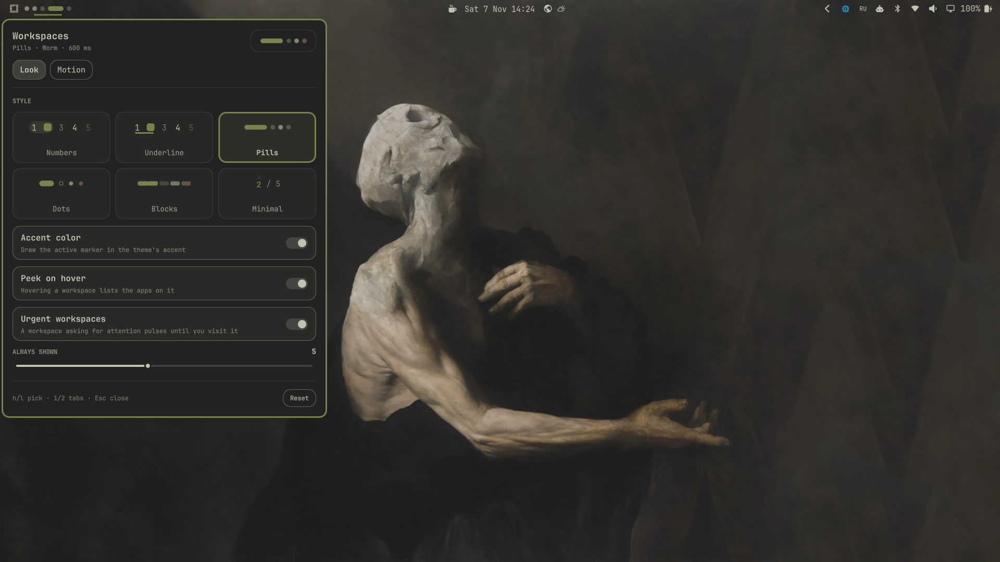
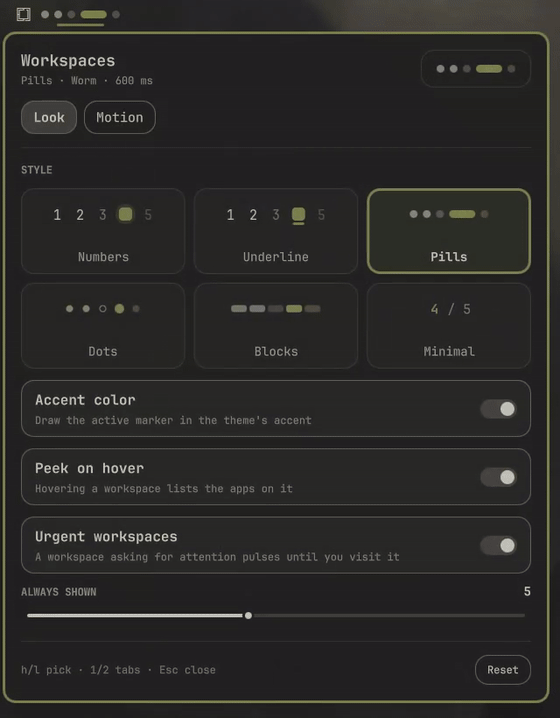
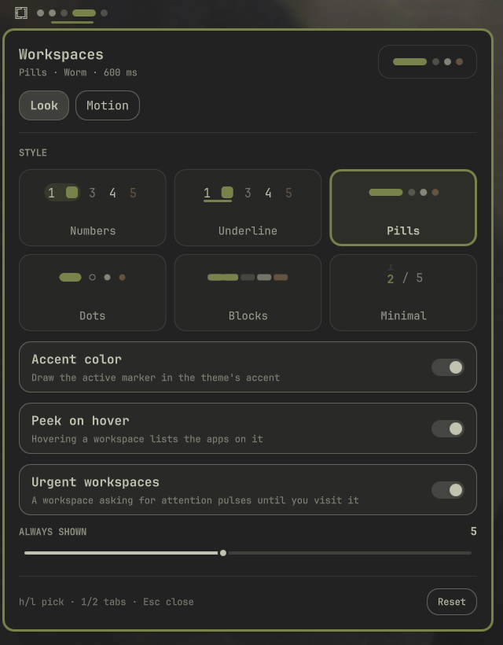
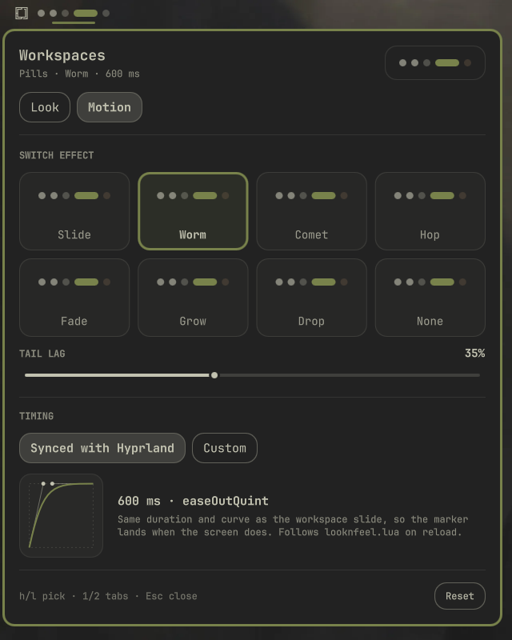

<div align="center">

# Workspace Styler

**Индикаторы рабочих столов для бара [Omarchy](https://omarchy.org): шесть стилей, восемь анимаций переключения, синхронизированных с анимацией самого Hyprland.**

[English](README.md)



</div>

<br>

<p align="center">
  
</p>

## Зачем

Стандартный виджет Omarchy показывает цифры. Этот даёт выбрать, как выглядит ряд и как маркер
переезжает при переключении, а главное, маркер приезжает **ровно тогда же**, когда и экран.
Плагин читает длительность и bezier-кривую анимации `workspacesIn` из Hyprland и ведёт маркер по
той же кривой. Изменишь `looknfeel.lua`, и после перезагрузки конфига плагин подстроится сам.

Всё, что умеет стандартный виджет, сохранено: свой блок воркспейсов у каждого монитора,
«гости» с отключённого монитора, клик для перехода, клик по активному меняет раскладку
(и `Super + L` тоже), колесо листает.

## Настройки

**Правый клик** по индикаторам. У каждого варианта карточка с живым превью, которое само
переключается между тестовыми столами.

<p align="center">
  
</p>

<table>
  <tr>
    <td align="center"><br><sub><b>Вид</b>: стиль, акцент, подсказки, срочные, число постоянных</sub></td>
    <td align="center"><br><sub><b>Анимация</b>: эффект, хвост, синхрон с Hyprland или своё время</sub></td>
  </tr>
</table>

## Что внутри

| Стили | Эффекты |
|---|---|
| **Цифры**: классика с мягкой подсветкой | **Скольжение**: маркер плавно переезжает |
| **Подчёркивание**: цифры с бегущей полоской | **Червяк**: голова вытягивается, хвост догоняет |
| **Pills**: точки и капсула, как в GNOME/Fedora | **Комета**: шлейф, который гаснет к прилёту |
| **Точки**: кольцо у пустого, заливка у занятого | **Прыжок**: маленький прыжок над рядом |
| **Блоки**: сплошные сегменты | **Растворение** · **Рост** · **Капля** · **Без анимации** |
| **Минимал**: только `3 / 5`, цифра прокручивается | |

**Время**

- **Синхронно с Hyprland** (по умолчанию). Длительность и кривая берутся из `hyprctl -j animations`
  с наследованием `workspacesIn → workspaces → global`, как в самом Hyprland. Если анимации
  в Hyprland выключены или отключены через `omarchy toggle animations`, переключение мгновенное.
- **Своё.** Своя длительность и кривая: Omarchy, классические, любые кривые из твоего конфига
  Hyprland или четыре свои точки bezier с живым графиком.

**Мелочи**

- **Подсказка при наведении** показывает, какие приложения открыты на столе.
- **Срочные столы**: стол, где окно просит внимания, пульсирует цветом urgent из темы, пока не зайдёшь на него.
- Акцентный цвет маркера, иконка раскладки на активном, сколько столов показывать всегда.
- Следует теме (цвета, скругления, масштаб шрифта), работает на вертикальном баре, говорит
  по-русски и по-английски, язык меняется на лету.

## Установка

```bash
omarchy plugin add https://github.com/SanchoKusika/omarchy-workspace-styler
```

Поставить на место стандартного виджета и выключить его:

```bash
omarchy plugin enable io.github.sanchokusika.workspace-styler --section left --after omarchy.workspaces
omarchy plugin disable omarchy.workspaces
```

Обновление: `omarchy plugin update io.github.sanchokusika.workspace-styler`.

<details>
<summary><b>Вернуть стандартный виджет</b></summary>

```bash
omarchy plugin enable omarchy.workspaces --section left --after io.github.sanchokusika.workspace-styler
omarchy plugin disable io.github.sanchokusika.workspace-styler
```
</details>

## Конфигурация

Панель пишет в запись виджета в `~/.config/omarchy/shell.json`, её можно править и руками.
Все значения проверяются, неизвестные заменяются значениями по умолчанию. Список ключей есть в
[английском README](README.md#configuration).

### IPC

```bash
omarchy-shell io.github.sanchokusika.workspace-styler toggle        # открыть или закрыть настройки
omarchy-shell io.github.sanchokusika.workspace-styler tab motion    # открыть на вкладке: look | motion
omarchy-shell io.github.sanchokusika.workspace-styler refresh       # перечитать раскладку и тайминги
```

В панели: `h` / `l` выбирают карточку, `1` / `2` переключают вкладки, `Esc` закрывает.

## Как работает синхронизация

Одна линейная величина идёт от 0 до 1 за время анимации Hyprland. Всё, что движется (края
маркера, ширина капсул, призраки кометы, дуга прыжка), считается из неё через ту же кубическую
bezier-кривую, что у Hyprland (`Motion.js`). Голова и хвост червяка идут по сдвинутым отрезкам
этого же интервала, поэтому любой эффект заканчивается одновременно со сдвигом рабочего стола.
Если переключиться посреди анимации, новая стартует оттуда, где маркер сейчас.

## Безопасность

- Весь собственный текст выводится как `Text.PlainText`.
- Имена приложений для подсказки приходят от чужих программ. Перед общим тултипом разметка
  в них обезвреживается, управляющие и bidi-символы удаляются, длина ограничивается.
- Значения из `shell.json` и вывод `hyprctl` проверяются и ограничиваются.
- Никакой сети, запускаются только `hyprctl` и команды раскладки самого Omarchy.

## Разработка

```bash
node --test tests/
omarchy plugin validate .
```

## Лицензия

[MIT](LICENSE) © SanchoKusika
